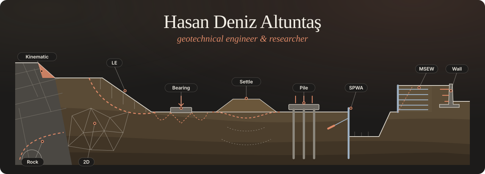

 

 

* 🏛️ Research & Development Chief Engineering, **General Directorate of Highways (KGM)** — 13th Regional Directorate, Antalya, Türkiye.

* 🎓 Research focus: **geotechnical engineering** — slope stability, sheet pile and retaining walls, consolidation — and **pavement mechanics** — rutting, critical strains, Marshall mix design.

* 🧠 Method mix: **finite element modelling** (Ferrite.jl, OpenSees, custom Python FEM) + **machine learning** and **Physics-Informed Neural Networks** trained on simulation and lab data.

* 💻 Currently building **SlipSurface** — an open-source suite of geotechnical analysis software (limit equilibrium, 2D FEM, retaining walls) with desktop GUIs and bilingual (TR / EN) reports.

* 💬 Open to collaboration on geotechnical / pavement research — reach me via [ORCID](https://orcid.org/0000-0001-7672-0483) or [LinkedIn](https://www.linkedin.com/in/hasan-deniz-altunta%C5%9F-phd-47b98a239).

### 🖥️ Projects & Products

<table style="table-layout:fixed;width:100%">
<tr><th colspan="3">SlipSurface — Geotechnical Software</th></tr>
<tr><th width="40%">Title</th><th width="12%">Stars</th><th width="48%">Tech / Links</th></tr>
<tr><td><a href="https://github.com/hdaltuntas/SlipSurfaceIQ-LE">SlipSurfaceIQ-LE</a> 2D limit equilibrium slope stability — Bishop, Spencer, GLE/M-P, FS contours, supports, PDF &amp; DXF</td><td></td><td>   </td></tr>
<tr><td><a href="https://github.com/hdaltuntas/SlipSurfaceIQ-FEA">SlipSurfaceIQ-FEA</a> 2D geotechnical FEM — strength reduction, staged construction, retaining structures, seepage</td><td></td><td>   </td></tr>
</table>

<table style="table-layout:fixed;width:100%">
<tr><th colspan="3">Machine Learning &amp; Research Code</th></tr>
<tr><th width="40%">Title</th><th width="12%">Stars</th><th width="48%">Technologies</th></tr>
<tr><td><a href="https://github.com/hdaltuntas/marshall-obc-prediction">Marshall OBC Prediction</a> Optimum bitumen content prediction from Marshall test data</td><td></td><td>  </td></tr>
</table>

<table style="table-layout:fixed;width:100%">
<tr><th colspan="3">Tools</th></tr>
<tr><th width="40%">Title</th><th width="12%">Stars</th><th width="48%">Technologies</th></tr>
<tr><td><a href="https://github.com/hdaltuntas/TermTrace">TermTrace</a></td><td></td><td></td></tr>
</table>

### 🛠️ Toolbox

📈 Stats

 

